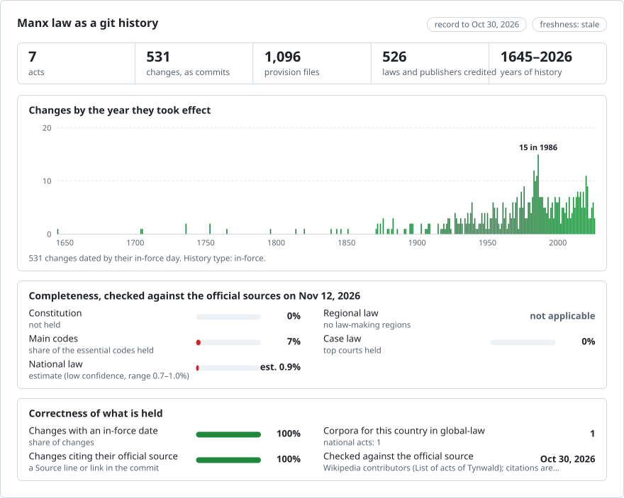

# Isle of Man: law history in git

<picture>
<source media="(prefers-color-scheme: dark)" srcset="data/effort-dark.svg">

</picture>

The law of the Isle of Man as a git history: one file per section, one commit per version on the day it took effect, and the act that made each change as the commit's author. `git blame` names the source of every line; `git log` lists every change to a section; picking a date gives the text in force that day.

Part of [lexifina/global-law](https://github.com/lexifina/global-law), one git history for every country's law: this is the Isle of Man's national law, which global-law reads at `isle-of-man/national/acts/`.

**What is in it now:** 1,139 sections of 149 Acts of Tynwald assented from 1704 to 1975 (among them the Evidence Act 1871, the Criminal Code 1872, the Companies Act 1931 and the Isle of Man Constitution Act 1961), each in one version, the official revised edition, and only the sections whose words are out of Crown copyright; 14 Acts of 1859 to 1871 as enacted, from Gill's printed Statutes of the Isle of Man (scan text, uncorrected); a catalogue of 855 Acts of Tynwald from 1645 to April 2026, by short title, citation and Royal Assent day only; and the Isle of Man's inception date from Wikidata. [`catalogue/README.md`](catalogue/README.md) lists every catalogued Act, and each Act's `README.md` its sections.

Each Act has its own folder, one file per section: `constitution-1961/s-006.md` is section 6 of the Isle of Man Constitution Act 1961 (AT 6 of 1961), the Speaker's right to abstain from voting in the Keys. A catalogue entry is `catalogue/at-<year>-<number>.md` (`catalogue/at-1991-008.md` is the Copyright Act 1991, AT 8 of 1991).

The text is in English, as the official revised editions print it.

## Questions as git commands

| Question | Command |
| --- | --- |
| Every change to section 6 of the Constitution Act 1961 | `git log -p --word-diff -- constitution-1961/s-006.md` |
| Who is credited with each line of section 6? | `git blame constitution-1961/s-006.md` |
| Every version of the Constitution Act 1961, with the day each took effect | `git log --format="%h %(trailers:key=In-force,valueonly,separator=) %an" -- constitution-1961` |
| Section 6 as in force on 1 January 2026 | `python tools/on.py 2026-01-01 constitution-1961 s-006` |

**Outside git**, we also host this record publicly, for free:

- **[Ask Claude about Manx law](https://global-law.lexifina.com/v1/try_claude?country=isle-of-man)**: opens Claude with a first question ready.
- **[Ask ChatGPT](https://global-law.lexifina.com/v1/try_chatgpt?country=isle-of-man)**: the same question in ChatGPT.
- **[Search Manx law on our site](https://lexifina.com/law?country=isle-of-man&q=witness)**: a search for "witness", with each provision's text and its versions, no account needed.
- **[Developer REST API](https://global-law.lexifina.com/v1/search_law?query=witness&jurisdiction=isle-of-man)**: the same search as JSON, with no key. See the [documentation here](https://lexifina.com/api/global-law).

Both assistants read the record through the free Global law connector (MCP, `https://global-law.lexifina.com/mcp`); the first time, the chat gives you the link that adds it. Ask in English.

**Host it yourself easily.** All it takes is git and Python, and the tools run on your machine:

```sh
git clone --depth 1 https://github.com/lexifina/global-law && cd global-law
python3 tools/countries.py add isle-of-man/national/acts
python3 tools/law.py show 2026-01-01 isle-of-man/national/acts/constitution-1961/s-006.md
```

Opened in Claude Code, Cursor, VS Code or Codex, the clone also starts a local MCP server with the same tools ([MCP.md](https://github.com/lexifina/global-law/blob/main/MCP.md)).

## Dates

Each commit is dated at noon, Europe/London, on the day the version took effect, and carries it in its `In-force:` trailer:

- for an Act's text, the day the Act itself prints: its commencement day, otherwise its promulgation ("Passed") day, otherwise its Royal Assent day (`In-force-basis` says which). Only sections with no amendment note are kept, so their words are as enacted. These versions were first dated by the day the revised edition was published or captured; `Kind: correction` commits of 27 November 2026 re-date them, and the earlier commits keep their first `In-force:` day;
- for an Act in `statutes-1860-1871/`, its promulgation day where the certificate printed after it is legible, otherwise its Royal Assent day (`In-force-basis: Royal Assent (promulgation day illegible in source OCR)`);
- for a catalogue entry, the Act's Royal Assent day, not its commencement; days before 1752 are given as the list gives them, with no change of calendar;
- git cannot store dates before 1970, so the 476 earlier commits are dated from 1970-01-01, one second apart, with the real day in `In-force:`. Ask for a date with `tools/on.py`, not `git log --before`.

No section is yet credited to an act: each Act's text is credited to its publisher, the Isle of Man Government, Attorney General's Chambers (legislation.gov.im), and each catalogue day to `Acts of Tynwald assented on <date>` (the first, 1645, to the Wikipedia list's contributors). The committer is always Lexifina.

## How it is checked

- `tools/check_repo.py` reads every version back from git on the day it took effect and on the day before, and compares it with the corpus; the results are in [`REPRODUCE.md`](REPRODUCE.md); a second build has not yet been compared.
- `tools/verify_acts.py` checks every kept section, letter for letter, against a second, independent text extraction of the same official PDF.
- Each Act's commit names the edition it was read from and lists every section left out, and why.
- History is append-only: no merge commits, no commit dated in the future, and every commit's trailers parse.
- [vulnerabilities/](vulnerabilities/): possible drafting mistakes in this law, found by global-law's detectors and checked by hand. Not run yet.

## What it does not show

- **Changes over time.** Each Act has one version, its current revised edition; amendments and earlier texts are not recorded.
- **Most of each Act.** Many sections are left out (275 of the first five Acts' 501): those changed by an instrument after 1975 or with an undated endnote, whose words may still be in copyright, those with any amendment note, whose current words have no printed day, and those showing fine amounts, which later Acts raised.
- **Acts assented from 1976.** They are Crown copyright and are in the catalogue only. Pre-1976 Acts with no archived revised edition, or no section free of amendment, are not here either.
- **Clean text of the 1859-1871 Acts.** `statutes-1860-1871/` is the uncorrected OCR of a scanned 1888 edition and has misread letters; 30 of its 44 Acts are held (no legible day, or the end of the text not found), and volumes I (1417-1824) and II (1824-1859) are not in yet. To read any Act in full, go to [legislation.gov.im](https://legislation.gov.im/).
- **Subsidiary legislation, case law and treaties.** None is here.
- **A complete catalogue.** The Wikipedia list it partly comes from is incomplete, Acts without a full Royal Assent date are left out, and repeals and long titles are not recorded.
- **Headings and notes.** Part headings, general notes and endnotes are not law text and are not in the files.

## Sources

| Source | Kind | Past versions | Notes |
| --- | --- | --- | --- |
| [legislation.gov.im](https://legislation.gov.im/) (Isle of Man Government, Attorney General's Chambers) | Official revised editions of the Acts of Tynwald (PDF), read from Internet Archive copies | no, the current edition only | The text of the 149 pre-1976 Acts (the archived copies of the further 144 used); the citation and Royal Assent day of 548 catalogue entries, from each Act's front matter |
| [The Statutes of the Isle of Man, vol. III](https://archive.org/details/statutesisleman01mangoog) (ed. J. F. Gill, printed by authority, 1888) | Acts of 1859-1871 as enacted; Google Books scan on the Internet Archive, its text layer | no, as enacted | Secondary copy, uncorrected OCR; each commit says so in its `Source-status`, `Text-source` and `In-force-basis` trailers |
| [List of acts of Tynwald](https://en.wikipedia.org/wiki/List_of_acts_of_Tynwald) (Wikipedia) | List of Acts | no | Short title, citation and Royal Assent day of the other entries, as facts; where both give a day, the official one is used |
| [Wikidata](https://www.wikidata.org/wiki/Q9676) | Legal-system facts (the inception date only) | no | CC0 |

## Licence

See [`LICENSE`](LICENSE). Copyright in an Act of Tynwald ends 50 years after the end of the year of Royal Assent (Copyright Act 1991, s 157(2)), so only words of Acts assented in 1975 or earlier, not put in by a later instrument, are copied; the editions' notes and layout are not. The 1888 edition of the Statutes is in the public domain. The catalogue holds facts only, and Lexifina's own work (the history, commit messages, tables and tools) is CC0 1.0.

No AI model wrote or changed legal text; the scripts were written by an AI model (see [`REPRODUCE.md`](REPRODUCE.md)).

## Visualisations

- [visualisations/](visualisations/): charts drawn from this repository. Not drawn yet.

## More

From [lexifina/global-law](https://github.com/lexifina/global-law):

- [FEATURES.md](https://github.com/lexifina/global-law/blob/main/FEATURES.md): every feature, and what every corpus must support (`git blame`, `law.py`, the MCP tools)
- [FAQ.md](https://github.com/lexifina/global-law/blob/main/FAQ.md): questions and answers · [CONTRIBUTING.md](https://github.com/lexifina/global-law/blob/main/CONTRIBUTING.md): proposing changes · [MCP.md](https://github.com/lexifina/global-law/blob/main/MCP.md): the MCP server · [REPRODUCE.md](https://github.com/lexifina/global-law/blob/main/REPRODUCE.md): how it was built · [CHANGELOG.md](https://github.com/lexifina/global-law/blob/main/CHANGELOG.md)
- [FRESHNESS.md](https://github.com/lexifina/global-law/blob/main/FRESHNESS.md): how current each corpus is · [Monitoring](https://github.com/lexifina/global-law/tree/main/monitoring): whether updates are running · [WATCHING.md](https://github.com/lexifina/global-law/blob/main/WATCHING.md): how each official source is watched for changes
- [performance/](https://github.com/lexifina/global-law/tree/main/performance): how fast the tools are, measured
- [visualisations/](https://github.com/lexifina/global-law/tree/main/visualisations): charts and bridges across the world's law
- [Vulnerabilities](https://github.com/lexifina/global-law/tree/main/vulnerabilities): mistakes in legislation as published
